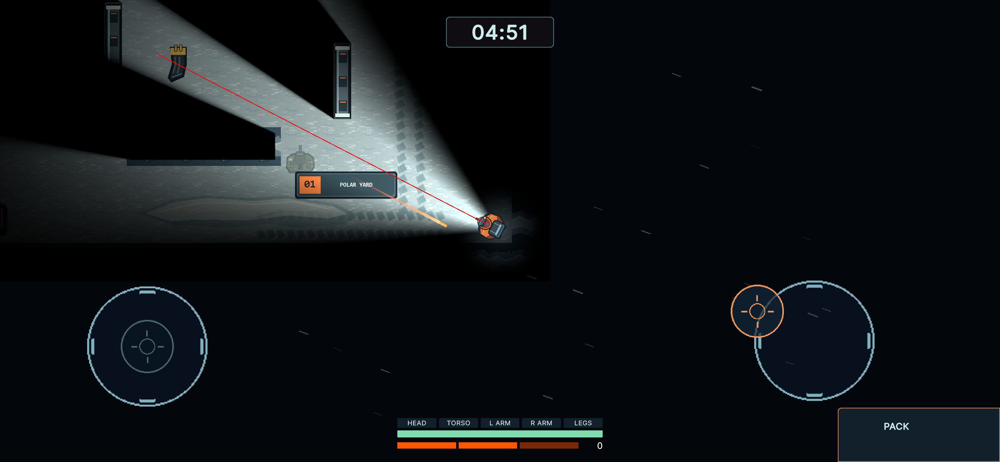

# GreedAndBleed

**Unity 6 · C# · Android & iOS · 2D Tactical Extraction Shooter**

A playable mobile extraction shooter vertical slice focused on gameplay systems, software architecture, and cross-platform development.

[Watch the gameplay demo](https://cdn.jsdelivr.net/gh/lAntonioLombardol/GreedAndBleed-Portfolio@main/media/gameplay.mp4) · [Download MP4](https://github.com/lAntonioLombardol/GreedAndBleed-Portfolio/raw/refs/heads/main/media/gameplay.mp4)

## Overview

GreedAndBleed features a complete offline extraction loop: prepare equipment, enter a raid, fight enemies, collect loot, and extract to preserve recovered items. Failed raids result in item loss.

## Technical Highlights

- **Architecture & Persistence:** Extenject dependency injection, project- and scene-scoped services, and versioned JSON persistence with integrity checks.
- **Asset Management:** Asynchronous Addressables loading, object pooling, and safe resource cleanup during scene transitions.
- **Gameplay Systems:** Projectile-based combat, state-driven enemy AI, inventory management, and extraction mechanics.

## Engineering Decisions

- **Combat:** Replaced the initial hitscan implementation with simulated projectiles and refined aiming feedback and collision consistency.
- **Asset Streaming:** Compared eager and streamed loading on Android hardware, using profiling results to guide the final implementation.

## Testing & Validation

- Automated Unity EditMode and PlayMode tests.
- Successful Android ARM64/IL2CPP build.
- Manual gameplay testing on Android and iPhone 11 Pro Max.
- Performance investigations on Android hardware.

## Development Workflow

GreedAndBleed was developed through an extensively **AI-assisted workflow**. I directed requirements and technical decisions, while AI tools contributed substantially to implementation. Solutions were evaluated through testing, technical review, and device validation.

## Project Status

**Completed playable vertical slice for Android and iOS.**

The full Unity source repository remains private, as the project may serve as the foundation for a future game.
